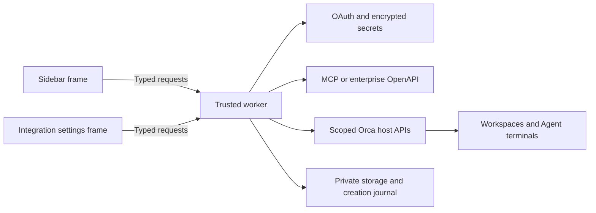

# Architecture

Meego for Orca separates presentation, provider access and native workspace effects. It currently implements Feishu Project / Meegle only. There are no Jira or Linear adapters.

This architecture requires the companion host pinned in [`.github/orca-sdk.json`](../.github/orca-sdk.json). Checked public Orca v1.4.257 lacks required settings/navigation and Agent discovery fields. The development engine floor is not a public compatibility guarantee. See [development](development.md) and [releasing](releasing.md).

## Runtime boundaries



The sidebar owns browsing, details and action-local drafts. The settings frame owns authorization, account and space management. It does not load work items, Agents or workspace context. Both use the same worker and credential store; their atoms, subscriptions and request generations are independent.

The trusted worker resolves the active connection, validates scope and invokes either provider operations or native host APIs. `src/protocol.ts` declares requests and events once by augmenting module `orca`; official host and worker types share that contract.

## Module responsibilities

| Modules | Responsibility |
| --- | --- |
| `worker.ts` | Entry point, connection handlers, read queries, creation and comments |
| `worker-workspace-actions.ts` | Workspace association, Agent discovery, handoff and integration-settings navigation |
| `worker-item-edits.ts` | Account, source and version checks around item and node mutations |
| `meego/oauth.ts`, `meego/connection.ts` | OAuth lifecycle, account/space selection and provider resolution |
| `meego/mcp-client.ts`, `meego/client.ts` | Personal MCP and enterprise OpenAPI adaptation |
| `meego/work-item-edit*.ts` | Field capabilities, real status transitions and role-member operations |
| `meego/work-item-nodes*.ts` | Explicit node inspection, requirements, revisions and node actions |
| `meego/workspace-inventory.ts`, `meego/workspace.ts`, `meego/links.ts` | Explicit inventory validation, focused-context compatibility, saved associations and terminal delivery |
| `meego/workspace-create.ts` | Durable creation plan, receipt, recovery and fixed-target association |
| `panel-*.tsx`, `settings.tsx` | Native declarative controls, scoped drafts and late-response protection |

These are plugin-relative paths under `src/`. Provider and host effects stay outside presentation modules. The shared JSON storage boundary lives in `meego/storage-json.ts`; it uses the host's JSON representation rather than broad type casts.

## Identity and scope

| Boundary | Captured identity | Revalidation |
| --- | --- | --- |
| Work item | Provider origin, project key, type and positive int64 ID | Returned item must match the requested source and type |
| Account | `expectedUserKey` from the displayed account | Worker rejects writes after an account change |
| Item mutation | Displayed `updatedAt` | Missing or changed versions cannot write |
| Node mutation | Selected node key and inspected revision | Required fields, requirements and revision are checked before sending |
| Workspace | Canonical workspace ID | Exact row in the complete cross-host inventory; invalid IDs never fall back to labels |
| Association | Workspace ID and `linkedAt` | Replacement, removal and linked handoff reject a changed saved link |
| New Agent | Explicit catalog ID and workspace ID | Installed/enabled host catalog is checked again before launch |

IDs outside JavaScript's safe integer range remain strings. JSON parsing, payload serialization, canonical URLs and adjacent-ID tests preserve the full positive int64 value.

A project key and its browser slug are separate values. Canonical links are checked against the expected origin, project, type and item ID. A valid provider receipt can use the project-key path even when the known browser slug differs.

Workspace names and branches are labels, not addresses. Old hosts may use a globally unique label/branch fallback. Ambiguous or truncated inventories remain unresolved and expose a recovery explanation. A supplied but invalid canonical ID cannot use that fallback.

The detail view selects a development workspace explicitly from the host inventory. Project, branch, host location and path are visible before linking; ambient focus is a suggestion, not authority to replace a selected target. Association and a new Agent session retain that fixed ID even if the person switches windows. Existing-terminal drafts retain the host's active-workspace membership boundary. A cached, unavailable or ambiguous workspace is not an executable target, and inventory errors remain visible with a retry action.

Association commits and Agent effects retain the originally resolved account, source and connection generation. The worker rechecks this scope inside the serialized link commit and immediately before sending a draft or launching an Agent; a late request cannot adopt a new ambient account or space.

## Capabilities and writes

The UI loads provider metadata before exposing an edit. A status action sends the provider's real transition ID. A role edit requires explicit selection of a configured role and sends only that role's membership changes. `current_status_operator` is a computed field and remains read-only.

Node actions require explicit selection and inspection. Owners belong to the selected node; aggregate current owners cannot stand in for them. Inherited role assignments, unknown schemas and unfinished requirements remain browser-only.

Each submission contains one operation. Explicit authorization rejection can trigger token refresh, but every subsequent send rechecks scope, cancellation and versions. An ambiguous transport or business outcome is never automatically replayed as a write.

Unverified item and node outcomes lock further writes to that target in the current frame. Recovery reads are read-only. The user can adopt the latest result, or explicitly confirm that the operation was not performed before preparing another submission. Adopting a readback is distinguished from confirming a successful save.

## Workspace creation journal

Creation uses a durable journal keyed by account, origin, project, type and item ID:

```text
ready → creating → created → linked
             ↘ uncertain
```

A ready plan fixes the source workspace, host and branch. The worker persists `creating` before dispatching the native create request and persists the receipt before association. The native request uses the official project/host creation API; the plugin journal prevents replay rather than inventing an unsupported host idempotency parameter. Refreshing an unsubmitted ready plan invalidates its previous plan ID.

A receipt identifies the new workspace directly. Association does not follow later focus changes and will not overwrite another saved work-item link. Creation stays in the background; opening the resulting workspace is a separate explicit request.

If creation is uncertain, the journal blocks duplicate creation until the original request settles and the user checks the result. An existing receipt can be recovered or association retried without another create. A confirmed-not-created action issues a fresh plan only after the original operation has settled. An ID-only or late success receipt is saved before inventory lookup; an inventory failure leaves a created result for explicit association retry.

## Native settings and handoff

The companion manifest contribution `location: "settings"` places the connection-only panel in native Settings → Integrations. Generic enterprise fields remain under the host's advanced-settings disclosure. `settings.open` is scoped to the calling plugin's integration page; it is not a route to global Agent settings.

The handoff view lists existing Agent terminals and offers an explicit new-session choice. Its new Agent selector comes from `agents.available` on the verified workspace host; the plugin does not accept arbitrary shell commands. Missing or removed choices cannot launch. A command without an existing Agent directs the user to this selector.

Existing terminals receive a sanitized single-line draft with `enter: false`, since an Agent may exit to its shell after inspection. New sessions use native `agent.launch` with an explicit catalog ID. Host acceptance of a launch is not proof that the Agent received or completed the task; terminal evidence is separate.

Work-item descriptions are external material and are quoted as such in the prompt. They do not authorize additional account, repository or external-service actions.

## Persistence and validation

| State | Lifetime |
| --- | --- |
| Credentials and OAuth tokens | Orca encrypted secrets |
| Selected account/space and workspace links | Plugin private storage |
| Workspace creation plan and receipt | Durable plugin journal |
| Item drafts and unverified edit/node locks | Current frame session |
| List caches, pending authorization and request generations | Worker or frame lifetime, depending on ownership |

Tests fake host and HTTP boundaries and use synthetic business data. They check payloads, scope changes, stale results, uncertainty and int64 identity. Fixture screenshots check native rendering separately. Installed-host RPC evidence, prior isolated Agent delivery and screenshots must not be presented as a completed full GUI flow. Current evidence and remaining gaps are recorded in the [README](../README.md#验证范围).

The work-item → workspace → Agent relationship provides a basis for future provider comparisons. Adding Jira or Linear would require a separate provider adapter and its own capability and outcome tests; no current module claims cross-provider equivalence.
